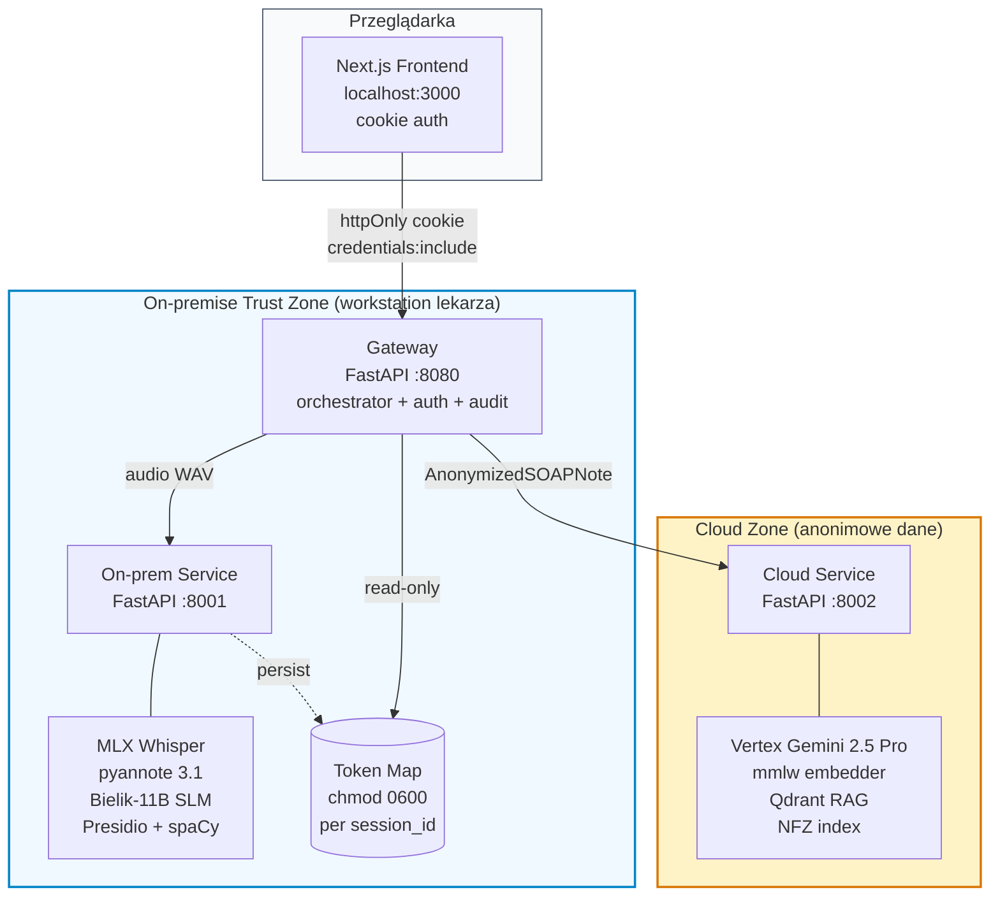
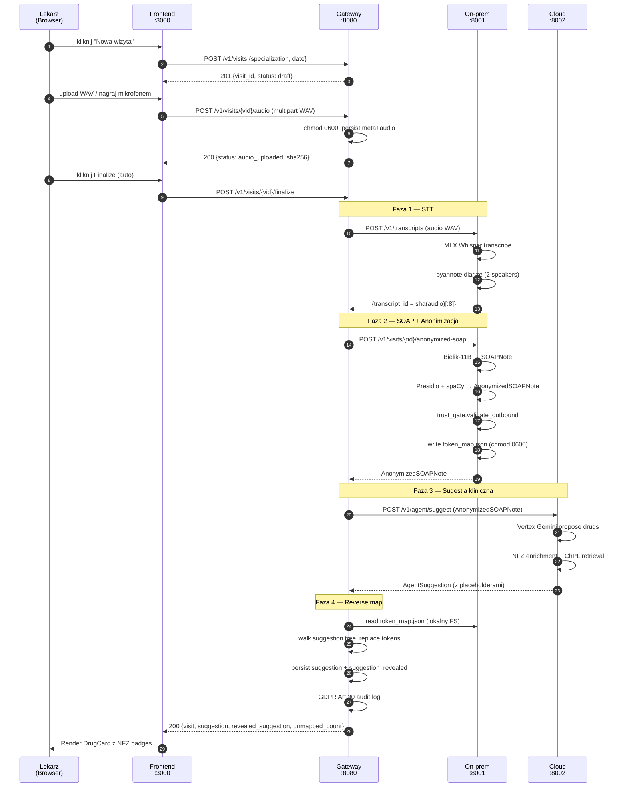
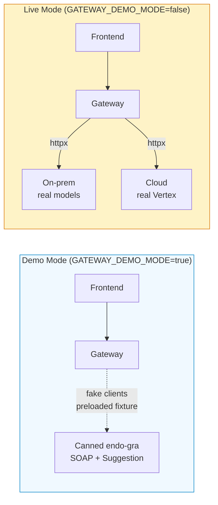
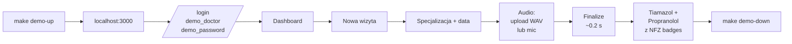
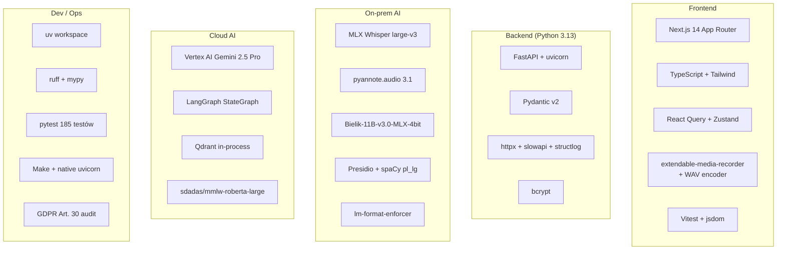

# MedVoicePL — Przewodnik operacyjny

> Praktyczny dokument: jak uruchomić, gdzie kliknąć, gdzie szukać logów, jak działają poszczególne warstwy. Komplementarny do `CLAUDE.md` (który zawiera decyzje projektowe i pełną historię zmian).

**Spis treści**

1. [Czym jest MedVoicePL](#1-czym-jest-medvoicepl)
2. [Architektura systemu](#2-architektura-systemu)
3. [Granica zaufania (trust boundary)](#3-granica-zaufania-trust-boundary)
4. [Przepływ danych — od audio do sugestii](#4-przepływ-danych--od-audio-do-sugestii)
5. [Szybki start](#5-szybki-start)
6. [Tryby pracy: demo vs live](#6-tryby-pracy-demo-vs-live)
7. [Komponenty — co, gdzie i jak](#7-komponenty--co-gdzie-i-jak)
8. [URL-e, porty, logi, pliki](#8-url-e-porty-logi-pliki)
9. [Codzienne workflowy](#9-codzienne-workflowy)
10. [Audyt, GDPR, bezpieczeństwo](#10-audyt-gdpr-bezpieczeństwo)
11. [Stos technologiczny](#11-stos-technologiczny)
12. [Struktura repozytorium](#12-struktura-repozytorium)
13. [Troubleshooting](#13-troubleshooting)
14. [Koszty operacyjne](#14-koszty-operacyjne)
15. [Linki do dokumentacji szczegółowej](#15-linki-do-dokumentacji-szczegółowej)

---

## 1. Czym jest MedVoicePL

System wspomagania decyzji klinicznych (CDSS) dla polskich lekarzy. Lekarz nagrywa wizytę, system:

1. **Transkrybuje** mowę polską (Whisper + diaryzacja per mówca)
2. **Strukturyzuje** rozmowę w notatkę SOAP (Subjective / Objective / Assessment / Plan)
3. **Anonimizuje** dane pacjenta (usuwa PESEL, imiona, adresy — zostawia kontekst kliniczny)
4. **Sugeruje leki** z refundacją NFZ przez chmurowy LLM (Vertex Gemini)
5. **Pokazuje wynik** lekarzowi z przywróconymi nazwiskami chorób (eponym filter)

Kluczowa zasada: **surowe audio i niezanonimizowane dane NIGDY nie wychodzą z on-prem trust zone**. Chmura widzi tylko anonimowy SOAP.

---

## 2. Architektura systemu



**ASCII fallback (jeśli mermaid się nie renderuje):**

```
┌─────────────────────────────────────────────────────────────┐
│  Browser (localhost:3000)                                   │
│  └── Next.js Frontend (cookie auth, credentials:include)    │
└────────────────────────────┬────────────────────────────────┘
                             │ HTTPS+Cookie
                             ▼
╔══════════════════════════════════════════════════════════════╗
║  ON-PREMISE TRUST ZONE (workstation lekarza)                 ║
║  ┌────────────────────────────────────────────────────────┐  ║
║  │  Gateway (FastAPI :8080)                               │  ║
║  │  ├── Auth (bcrypt + httpOnly cookie)                   │  ║
║  │  ├── Visit lifecycle + state machine                   │  ║
║  │  ├── Orchestrator (transcribing→anonymizing→suggest…)  │  ║
║  │  ├── Reverse map (token → original)                    │  ║
║  │  └── GDPR Art. 30 audit                                │  ║
║  └────────────────────────────────────────────────────────┘  ║
║      │                    │                       ▲          ║
║      │ HTTP (audio)       │ HTTP (anon SOAP)      │ read     ║
║      ▼                    │                       │ token    ║
║  ┌──────────────────────┐ │      ┌────────────────┴────────┐ ║
║  │ On-prem (:8001)      │ │      │ Token Map (chmod 0600)  │ ║
║  │ ├── MLX Whisper      │ │      └─────────────────────────┘ ║
║  │ ├── pyannote         │ │                                  ║
║  │ ├── Bielik-11B SLM   │ │                                  ║
║  │ └── Presidio + spaCy │ │                                  ║
║  └──────────────────────┘ │                                  ║
╚═══════════════════════════│══════════════════════════════════╝
                            │ TRUST BOUNDARY (only AnonymizedSOAPNote crosses)
                            ▼
┌──────────────────────────────────────────────────────────────┐
│  CLOUD ZONE (anonimowe dane)                                 │
│  ┌────────────────────────────────────────────────────────┐  │
│  │ Cloud Agent (FastAPI :8002)                            │  │
│  │  ├── Vertex Gemini 2.5 Pro                             │  │
│  │  ├── mmlw-roberta-large embedder                       │  │
│  │  ├── Qdrant (in-process RAG, ChPL excerpts)            │  │
│  │  └── NFZ index (619 substancji, ATC mapping)           │  │
│  └────────────────────────────────────────────────────────┘  │
└──────────────────────────────────────────────────────────────┘
```

---

## 3. Granica zaufania (trust boundary)

**Reguła**: tylko jeden typ danych przekracza granicę on-prem → cloud — `AnonymizedSOAPNote`.

| Kierunek | Co przekracza | Co NIE przekracza |
|---|---|---|
| **on-prem → cloud** | `AnonymizedSOAPNote` (tylko klinika, placeholdery typu `<PERSON_1>` zamiast nazwisk) | Surowe audio, transkrypt, SOAP z PII, token map |
| **cloud → on-prem** | `AgentSuggestion` (drugs, tests, referrals — bez nazwisk pacjenta) | Cokolwiek innego |
| **gateway → frontend** | `revealed_suggestion` z prawdziwymi nazwami eponym + `unmapped_token_count` | Surowe placeholdery (frontend renderuje wyłącznie revealed) |

**Egzekwowanie:**

1. **`trust_gate.py`** w on-prem — przed wysłaniem `AnonymizedSOAPNote`, deterministyczny 3-check (~10 ms): typ, regex PII patterns (PESEL/phone/NIP/email), charset whitelist
2. **AST-walk lint** w testach (`test_trust_boundary_imports.py`) — gateway/cloud nie mogą importować nic z `on_premise.{stt,structuring,anonymization}.*`
3. **httpx-only-via-clients lint** — gateway może rozmawiać z cloudem TYLKO przez `gateway.clients.cloud._HttpxCloudClient`
4. **Token map fizycznie zostaje on-prem** — chmod 0600 na lokalnym FS, gateway czyta przez plik (nie przez sieć)

**Co to daje thesis-wise:** twierdzenie *"chmura jest identity-oblivious"* jest code-level enforced, nie tylko architektonicznie udokumentowane.

---

## 4. Przepływ danych — od audio do sugestii



**Czas trwania:**

| Faza | Cold start (1. raz) | Warm cache |
|---|---|---|
| 1. STT (MLX Whisper + pyannote) | ~30 s (model load) + ~10 s/min audio | <1 s (cache by audio SHA) |
| 2. SOAP (Bielik-11B) + anonimizacja | ~120 s | <1 s (cache by transcript_id) |
| 3. Vertex Gemini + RAG | ~9 s | <1 s (cache by SOAP SHA) |
| 4. Reverse map + audit | <0.1 s | <0.1 s |
| **Total (live)** | **~160-180 s** | **~0.3 s** |
| **Total (demo)** | ~0.2 s (fakes) | ~0.2 s |

**Stany wizyty (`VisitStatus`):**

```
draft ──upload audio──▶ audio_uploaded ──finalize──▶ transcribing
                                                         │
                                                         ▼
                              completed ◀──suggesting──── anonymizing
                                                         │
                                                         ▼
                                                       failed
```

---

## 5. Szybki start

### Demo mode (5 minut, bez modeli)

```bash
cd /Users/kubaboczar/repos/MedVoicePL
make demo-up
```

Otwórz **http://localhost:3000** → login `demo_doctor` / `demo_password` → Nowa wizyta → upload jakikolwiek WAV → wynik w ~0.2 s (zawsze Tiamazol + Propranolol — to canned fixture).

`make demo-down` żeby zatrzymać.

### Live mode (z prawdziwym Vertex AI + modelami)

```bash
make preflight-live      # sprawdzi env, gcloud auth, modele HF
make live-up             # boot on-prem + cloud (background)
sleep 30                 # warmup (spaCy + LLM klienty)
make gateway-up-live     # gateway w live mode (8080)
make frontend-up         # frontend (3000)
```

Otwórz **http://localhost:3000**, upload audio, finalize zajmie **~3 min na cold start**, kolejne ~0.3 s.

`make live-down` + `make frontend-down` żeby zatrzymać.

---

## 6. Tryby pracy: demo vs live



| Aspekt | Demo | Live |
|---|---|---|
| Wymaga GPU/MLX | ❌ | ✅ (M-series Mac, ~24 GB RAM) |
| Wymaga Vertex auth | ❌ | ✅ (gcloud ADC) |
| Wymaga HF token | ❌ | ✅ (pyannote license) |
| Czas pierwszej wizyty | <1 s | ~3 min |
| Czas kolejnych wizyt | <1 s | ~0.3 s (cache) |
| Czy sugestia odzwierciedla audio | ❌ (ta sama) | ✅ |
| Koszt | $0 | ~$0.10/wizyta (Vertex) |
| Kiedy używać | UI dev, demo na obronie, debug frontendu | E2E test, weryfikacja klinicznej poprawności |

---

## 7. Komponenty — co, gdzie i jak

### 7.1 Frontend — Next.js (`application/frontend/`)

**Co robi:** UI lekarza. Login form, dashboard z listą wizyt, formularz nowej wizyty, audio uploader (file + mic), progress bar finalize, karty leków z badge'ami refundacji NFZ.

**Co kluczowe:**

| Plik | Rola |
|---|---|
| `src/app/layout.tsx` | RootLayout, font Inter, QueryClient provider |
| `src/app/login/page.tsx` | Login form |
| `src/app/page.tsx` | Dashboard — lista wizyt z localStorage |
| `src/app/visits/new/page.tsx` | Formularz nowej wizyty |
| `src/app/visits/[id]/page.tsx` | Stage-driven UI (uploader → progress → wynik) |
| `src/components/AudioUploader.tsx` | Plik + mikrofon, dwa taby |
| `src/components/FinalizeProgress.tsx` | 5-fazowy progress + 1s polling |
| `src/components/DrugCard.tsx` | Karta leku z NFZ badge + provenance |
| `src/lib/api.ts` | Typed fetch wrappers (8 endpointów) |
| `src/hooks/useMicRecorder.ts` | MediaRecorder z WAV encoder + RMS meter |
| `tailwind.config.ts` | Design tokens (slate + sky-600 + refund tiers) |

**Zarządzanie stanem:**
- **Server state** — `@tanstack/react-query` (auth, visits, finalize, health)
- **Client state** — `zustand` z `persist` middleware (localStorage `medvoicepl.visits`)

**Build artifact:** `application/frontend/.next/` (gitignored)

---

### 7.2 Gateway — FastAPI (`application/gateway/`)

**Co robi:** Mediator między frontendem a on-prem/cloud. Auth, visit lifecycle, audio storage, orchestration, reverse map, audit, CORS, rate-limit.

**Endpointy (8):**

| Endpoint | Co robi |
|---|---|
| `POST /v1/auth/login` | Login → 204 + httpOnly cookie |
| `POST /v1/auth/logout` | Invalidate session |
| `GET /v1/auth/me` | Identity probe |
| `POST /v1/visits` | Stwórz draft visit |
| `POST /v1/visits/{vid}/audio` | Upload WAV (multipart, 50 MB cap) |
| `GET /v1/visits/{vid}` | VisitSummary (NO PII) |
| `POST /v1/visits/{vid}/finalize` | Cały orchestrator chain |
| `GET /v1/health` | Status downstream services |

**Konfiguracja** (`.env`):
- `GATEWAY_DOCTOR_USERNAME`, `GATEWAY_DOCTOR_PASSWORD_HASH` (bcrypt)
- `GATEWAY_DEMO_MODE` — `true`/`false`
- `ON_PREMISE_API_URL`, `CLOUD_API_URL`
- `GATEWAY_CORS_ORIGINS` (csv)
- `GATEWAY_AUDIT_RETENTION_DAYS` (default 730)

**Persisted dane:**
```
application/gateway/output/
├── sessions/<sid>.json           (chmod 0600)
└── visits/<vid>/
    ├── meta.json                  visit metadata
    ├── audio.wav                  uploaded audio
    ├── soap.json                  AnonymizedSOAPNote (audit)
    ├── suggestion.json            raw AgentSuggestion
    └── suggestion_revealed.json   po reverse map

application/gateway/audit/<YYYY-MM-DD>/
├── _login/logins.jsonl            wszystkie próby logowania
└── <vid>/
    ├── visit_create.json
    ├── visit_complete.json
    └── visit_failure.json
```

---

### 7.3 On-prem service — FastAPI (`application/on_premise/`)

**Co robi:** STT (Whisper), diaryzacja (pyannote), SOAP extraction (Bielik-11B SLM), anonimizacja (Presidio + spaCy + 6 polskich recognizers + eponym filter).

**Endpointy:**

| Endpoint | Co robi |
|---|---|
| `GET /v1/health` | Status, version |
| `POST /v1/transcripts` | Audio WAV → transcript_id (STT + diaryzacja) |
| `POST /v1/visits/{tid}/anonymized-soap` | transcript_id → `AnonymizedSOAPNote` |

**Modele (live mode):**
- **MLX Whisper** large-v3 (`mlx-community/whisper-large-v3-mlx`) — ~6 GB
- **pyannote** speaker-diarization-3.1 — ~500 MB
- **Bielik-11B-MLX-4bit** (`speakleash/Bielik-11B-v3.0-Instruct-MLX-4bit`) — ~6 GB
- **spaCy** `pl_core_news_lg` — ~547 MB
- **Presidio** + 6 custom polskich recognizers (PESEL/NIP/Phone/IDCard/Address/NameBooster)
- **Eponym filter** — ~120 polskich eponimów medycznych (Phase 2c.1)

**Persisted dane:**
```
application/on_premise/output/
├── transcripts/<tid>/transcript.json   (deterministyczny tid = sha(audio)[:8])
└── anonymized/<tid>/
    ├── anonymized_soap.json
    └── cache_key.json                  idempotency

application/on_premise/audit/<YYYY-MM-DD>/<session_id>/
├── audit.json                          GDPR Art.30 PII replacements
├── trust_gate.json                     pass/fail decision
└── token_map.json                      chmod 0600, mapa <PERSON_n> → original
```

---

### 7.4 Cloud service — FastAPI (`application/cloud/`)

**Co robi:** Cloud agent — proponuje leki (Vertex Gemini), wzbogaca o NFZ refundację, robi RAG po ChPL excerpts.

**Endpointy:**

| Endpoint | Co robi |
|---|---|
| `GET /v1/health` | Status, llm_loaded, nfz_index_size |
| `POST /v1/agent/suggest` | `AnonymizedSOAPNote` → `AgentSuggestion` |

**Architektura:** 3-node LangGraph StateGraph:
1. `propose_candidates` — Vertex Gemini 2.5 Pro structured output
2. `enrich_from_nfz` — deterministyczny lookup w 619-entry NFZ index + lazy `LazyAtcResolver` (cache na dysku)
3. `compose_suggestions` — RAG po 13 ChPL excerpts (Qdrant in-process + mmlw-roberta-large embedder)

**Konfiguracja** (`.env`):
- `GOOGLE_CLOUD_PROJECT`, `GOOGLE_CLOUD_LOCATION`, `VERTEX_AGENT_MODEL=gemini-2.5-pro`
- `NFZ_INDEX_DIR`, `CHPL_CORPUS_DIR`, `QDRANT_PATH`, `EMBEDDING_MODEL`

---

## 8. URL-e, porty, logi, pliki

### URLe

| Serwis | URL | Demo? | Live? |
|---|---|---|---|
| Frontend | http://localhost:3000 | ✅ | ✅ |
| Frontend login | http://localhost:3000/login | ✅ | ✅ |
| Frontend Swagger nie ma — to JS app | — | — | — |
| Gateway API | http://localhost:8080 | ✅ | ✅ |
| Gateway health | http://localhost:8080/v1/health | ✅ | ✅ |
| Gateway Swagger UI | http://localhost:8080/docs | ✅ | ✅ |
| On-prem API | http://localhost:8001 | ❌ (demo skip) | ✅ |
| On-prem Swagger UI | http://localhost:8001/docs | ❌ | ✅ |
| Cloud API | http://localhost:8002 | ❌ | ✅ |
| Cloud Swagger UI | http://localhost:8002/docs | ❌ | ✅ |

> **Uwaga (krytyczna)**: w przeglądarce zawsze używaj `localhost`, NIE `127.0.0.1`. Browser cookie matching jest per-hostname; mieszanie ich łamie sesję (frontend ma to wbudowane, ale jeśli ręcznie testujesz curl-em, trzymaj się `localhost`).

### Logi (background processes)

| Proces | Plik logu | Tail komenda |
|---|---|---|
| Gateway | `/tmp/medvoicepl-gateway.log` | `make gateway-logs` |
| Frontend | `/tmp/medvoicepl-frontend.log` | `tail -f /tmp/medvoicepl-frontend.log` |
| On-prem | `/tmp/medvoicepl-onprem.log` | `tail -f /tmp/medvoicepl-onprem.log` |
| Cloud | `/tmp/medvoicepl-cloud.log` | `tail -f /tmp/medvoicepl-cloud.log` |

PID files: `/tmp/medvoicepl-{gateway,frontend,onprem,cloud}.pid`

### Persisted dane

| Co | Lokalizacja | Gitignored? | Permissions |
|---|---|---|---|
| Sessions | `application/gateway/output/sessions/` | ✅ | 0600 |
| Visits | `application/gateway/output/visits/<vid>/` | ✅ | default |
| Gateway audit | `application/gateway/audit/` | ✅ | 0600 |
| On-prem transcripts | `application/on_premise/output/transcripts/` | ✅ | default |
| On-prem anonymized | `application/on_premise/output/anonymized/` | ✅ | default |
| Token maps | `application/on_premise/audit/<date>/<sid>/token_map.json` | ✅ | **0600** |
| GDPR audit | `application/on_premise/audit/<date>/<sid>/audit.json` | ✅ | default |
| Vitest cache | `application/frontend/coverage/` | ✅ | default |
| Next build | `application/frontend/.next/` | ✅ | default |

### Konfiguracja

| Plik | Co |
|---|---|
| `.env` | Wszystkie sekretne env vars (HF token, Vertex, password hash, etc.) |
| `.env.example` | Template — referencyjny |
| `application/gateway/configs/` | (stub, dla Phase 4) |
| `application/on_premise/configs/{whisper,slm,presidio,trust_boundary}.yaml` | Per-model config |
| `application/cloud/data/nfz_formulary/index_*.json` | Snapshot NFZ refundacji |
| `application/cloud/data/chpl_excerpts/*.md` | RAG corpus (ChPL excerpts) |
| `application/frontend/next.config.mjs` | Frontend config (gateway URL, etc.) |
| `application/frontend/tailwind.config.ts` | Design tokens |

---

## 9. Codzienne workflowy

### 9.1 Klikalna ścieżka demo (dla obrony / pokazu)



### 9.2 Dev iteration na frontendzie

```bash
make gateway-up                         # gateway w demo mode (background)
cd application/frontend
npm run dev                             # foreground, hot reload na :3000
```

Edytuj komponenty / Tailwind → reload automatycznie. Po skończeniu `Ctrl+C` + `make gateway-down`.

### 9.3 Live test z prawdziwym audio

```bash
make preflight-live                     # 14 checks
make live-up                            # on-prem + cloud (~30 s warmup)
make gateway-up-live                    # gateway live
make frontend-up                        # frontend
make smoke-3b-live                      # automated E2E z dialogue.wav
# albo klikalnie: http://localhost:3000
make live-down && make frontend-down
```

### 9.4 Debug konkretnego komponentu

| Co debugować | Gdzie patrzeć |
|---|---|
| Login 401 | `/tmp/medvoicepl-gateway.log` — sprawdź czy hash z `.env` się ładuje |
| Frontend pokazuje "Cloud niedostępny" | `make gateway-status` + `tail /tmp/medvoicepl-cloud.log` |
| Mikrofon nie nagrywa | DevTools → Console (browser permissions) |
| Finalize timeout | `tail -f /tmp/medvoicepl-onprem.log` (Bielik chunking) |
| Whisper bez polskich znaków | `application/on_premise/configs/whisper.yaml` — `language: pl` |
| Vertex auth wygasł | `gcloud auth application-default login` + `make cloud-down && make cloud-up` |
| Eponym `Gravesa` jest tokenizowany jako `<PERSON>` | `application/on_premise/data/medical_eponyms.json` |
| Brak leków w sugestii | `tail /tmp/medvoicepl-cloud.log` — Vertex response |

### 9.5 Reset wszystkiego (clean state)

```bash
make demo-down && make live-down && make frontend-down 2>/dev/null
rm -f /tmp/medvoicepl-*.{pid,log}
rm -rf application/gateway/output/sessions/* application/gateway/output/visits/*
# (audit logs zostają per GDPR retention)
```

---

## 10. Audyt, GDPR, bezpieczeństwo

### Granica trust:

```
┌─────────────────────────────────────────────┐
│ Browser ↔ Gateway: cookie auth (httpOnly)   │
└─────────────────────────────────────────────┘
              ↓
┌─────────────────────────────────────────────┐
│ Gateway ↔ On-prem: HTTP localhost (no auth) │   ← single-doctor demo
│ Gateway ↔ Cloud:   HTTP localhost (no auth) │
└─────────────────────────────────────────────┘
              ↓
┌─────────────────────────────────────────────┐
│ Cloud → Vertex: gcloud ADC (Bearer token)   │
│ On-prem → HF:   HUGGINGFACE_TOKEN (Bearer)  │
└─────────────────────────────────────────────┘
```

W produkcji szpitalnej Phase 3b → 3c przez reverse proxy z TLS (Caddy/nginx) i mTLS między mikrouserwisami. Phase 4.

### GDPR Art. 30 — co audytujemy:

**On-prem audit log** (per session): każda anonimizacja zostaje udokumentowana z:
- `entity_type` (PERSON, PESEL, PHONE, …)
- `token` (placeholder, np. `<PERSON_1>`)
- `original_sha256` (NIE plaintext!)
- `purpose=anonymization`, `legal_basis=Art_9_2_h` (medical)
- `controller`, `retention_until` (default +730 dni)

**Gateway audit log** (per visit):
- login attempts (success/fail, IP)
- visit_create, visit_complete (drug counts only — operacyjne, nie kliniczne)
- visit_failure (error_type + redacted message przez `pii_filter`)

**Token map separation:**
- Audit log → SHA tylko, brak plaintext
- Token map → plaintext, ALE chmod 0600, **fizycznie nie wychodzi z on-prem**
- Doctor reverse view → gateway czyta token map z lokalnego FS (nie przez sieć), aplikuje, zwraca

### Co NIE jest auditowane (świadomie):

- Surowe audio — bo zawiera mowę pacjenta z natury, gateway nie dotyka contentu
- Nieanonimizowany SOAP — żyje wyłącznie w pamięci Bielika, nigdzie nie persistuje
- Vertex prompts/responses — Vertex sam nie loguje (per Google Cloud privacy policy)

---

## 11. Stos technologiczny



### Wybory kluczowe i dlaczego:

| Wybór | Alternatywy odrzucone | Dlaczego |
|---|---|---|
| Next.js App Router | Pages router, Remix, Vite SPA | Modern Next, server components na przyszłość, najmniej tarcia |
| MLX (Apple Silicon) | faster-whisper CPU, Coqui | ~5-10× szybciej na M5 (10-core GPU + Metal) |
| Bielik-11B-v3.0 | PLLuM, GPT-4 API | Polish-native, lokalny (trust boundary), 32K context, ungated MLX repack |
| Vertex Gemini 2.5 Pro | OpenAI, Anthropic | $300 free credit, structured output, polski OK |
| pyannote 3.1 | WhisperX | Czysty Protocol, znany w docs, brak dodatkowych zależności |
| Presidio + spaCy | Regex-only | spaCy daje PERSON/LOCATION dla polskich nazwisk; Presidio orchestruje |
| Qdrant in-process | Pinecone, Chroma | No external service, persistence na dysku, free |
| Tailwind | CSS modules, styled-components | Najszybsze do napisania medical-clean theme |
| zustand | Redux, jotai | Mały, persist middleware, zero boilerplate |
| Native uvicorn (nie Docker) | docker-compose | On-prem image to ~6 GB MLX + spaCy; build per service to dzień. Native działa lepiej dla thesis demo |

---

## 12. Struktura repozytorium

```
MedVoicePL/
├── application/
│   ├── frontend/              # Phase 3c: Next.js doctor dashboard
│   │   ├── src/{app,components,hooks,lib,styles}
│   │   ├── __tests__/
│   │   ├── package.json + tailwind.config.ts + tsconfig.json
│   │   └── next.config.mjs
│   ├── gateway/               # Phase 3b: orchestrator + auth + audit
│   │   ├── src/gateway/{api,clients,middleware,*.py}
│   │   ├── scripts/{run_gateway,smoke_e2e,preflight_live}.py
│   │   └── tests/
│   ├── on_premise/            # Phase 2a-c.1: STT + SLM + anonimizacja
│   │   ├── src/on_premise/{stt,structuring,anonymization,api,trust_gate}/
│   │   ├── configs/{whisper,slm,presidio,trust_boundary}.yaml
│   │   ├── data/medical_eponyms.json
│   │   └── scripts/{run_transcription,run_soap_extraction,run_anonymization}.py
│   ├── cloud/                 # Phase 3a: LangGraph agent + RAG + NFZ + Vertex
│   │   ├── src/cloud/{api,llm_integration,rag,nfz,orchestrator}.py
│   │   ├── data/{nfz_formulary/,chpl_excerpts/}
│   │   └── scripts/run_agent.py
│   └── shared/                # Cross-tier Pydantic schemas (trust boundary)
│       └── src/shared/schemas/{anonymized,agent,drug,visit}.py
│
├── dataset_pipeline/          # Phase 1: synthetic dataset generator
│   ├── src/dataset_pipeline/{scenario_generator,tts_engine,postprocessing}/
│   ├── output/{scenarios,audio}/   (gitignored)
│   └── scripts/{run_generation,run_synthesis,fetch_*}.py
│
├── research_and_testing/      # Phase 4 (eval pipelines)
│   ├── evaluation/{stt_eval,slm_eval,rag_eval}/
│   └── scripts/eval_*.py
│
├── .claude/plans/             # Plan files (per phase)
├── CLAUDE.md                  # Pełna historia decyzji + zmian (~1000 linii)
├── GUIDEBOOK.md               # Ten plik
├── Makefile                   # ~30 targetów: install, test, gateway-up, demo-up, ...
├── pyproject.toml             # uv workspace root + lint config
├── .env.example               # Template wszystkich env vars
└── docker-compose.yml.disabled  # Phase 4 (deferred)
```

**Każdy z 5 workspace members** (`dataset_pipeline`, `application/{on_premise,cloud,gateway,shared}`) ma własny `pyproject.toml` z osobnymi deps. Frontend jest oddzielnym npm projektem.

**Test count**: 185 backend + 10 frontend = **195/195 zielonych** (stan na 2026-05-06).

---

## 13. Troubleshooting

### Login nie działa

| Symptom | Przyczyna | Fix |
|---|---|---|
| Frontend: 401 mimo poprawnego hasła | Frontend gada z `127.0.0.1`, cookie set on `localhost` (lub odwrót) | Zawsze otwieraj `http://localhost:3000` (NIE `127.0.0.1:3000`). `next.config.mjs` ma poprawny `localhost:8080` |
| Curl: 401 mimo poprawnego hasła | Stale env var w shell shadowuje `.env` | `make gateway-down && make gateway-up` (świeży proces) |
| Login timeout | Gateway nie odpowiada | `make gateway-status` — jeśli "not reachable" → `make gateway-up` |
| Login przechodzi ale `/me` 401 zaraz po | Cookie set na innej domenie niż frontend wysyła | Hard refresh (Cmd+Shift+R) ALBO incognito |

### Audio / mikrofon

| Symptom | Fix |
|---|---|
| "Brak dostępu do mikrofonu" | Site settings (kłódka w pasku adresu) → Microphone → Allow → reload |
| "Nie wykryto mikrofonu" | Sprawdź czy mic jest podłączony i wybrany w System Preferences → Sound |
| Po uploadzie błąd 415 | Upewnij się że plik to WAV (nie MP3, nie OGG). Mikrofon w UI sam emituje WAV |
| Nagranie 0 sekund | Browser blokuje getUserMedia — sprawdź console (F12) |

### Live mode

| Symptom | Fix |
|---|---|
| `make live-up` failuje | `make preflight-live` — pokaże dokładnie czego brakuje |
| Vertex auth wygasł (cloud log: "RuntimeError: GOOGLE_CLOUD_PROJECT") | `gcloud auth application-default login` + `make cloud-down && make cloud-up` |
| pyannote license error | Wejdź na huggingface.co/pyannote/speaker-diarization-3.1 → Accept license → ponów |
| MLX Whisper / Bielik długo się ładuje (>2 min) | Pierwsze ładowanie jest długie. Drugie wywołanie tego samego modelu = sekundy |
| Finalize timeout | Bielik chunk + cold start = łatwo 3 min. httpx timeout 300 s już jest. Jeśli >5 min — `tail /tmp/medvoicepl-onprem.log` |
| 502 Bad Gateway | Sprawdź czy on-prem żyje (`curl :8001/v1/health`) i cloud (`curl :8002/v1/health`) |

### Frontend dev

| Symptom | Fix |
|---|---|
| Build fails | `cd application/frontend && rm -rf .next node_modules && npm install && npm run build` |
| Hot reload nie działa | `npm run dev` zamiast `npm start`; sprawdź że nic innego nie zajmuje :3000 |
| TypeScript errors po pull | `npm install` (nowe deps) |

---

## 14. Koszty operacyjne

| Składnik | Cena | Per-wizytę (live cold start) |
|---|---|---|
| Vertex Gemini 2.5 Pro | ~$2.50 / 1M input + ~$10 / 1M output | ~$0.05–0.10 |
| Embedding (mmlw, lokalne) | $0 | $0 |
| Whisper / Bielik (MLX, lokalne) | $0 (CPU/GPU lokalny) | $0 |
| Storage audio + audit | $0 (lokalny dysk) | <1 MB |
| Frontend hosting | $0 (lokalnie) | $0 |
| **Total** | | **~$0.10/wizyta** |

**Free tier:** $300 Vertex AI credits → ~3000 wizyt darmowo.

**Phase 4 / production**: dokumentacja kosztu szpitalnego deployment na ~10000 wizyt/miesiąc to dodatkowa praca.

---

## 15. Linki do dokumentacji szczegółowej

| Co | Gdzie |
|---|---|
| Pełna historia decyzji + changelog | [CLAUDE.md](CLAUDE.md) |
| Plan Phase 3b (gateway) | [.claude/plans/phase-3b-gateway.md](.claude/plans/phase-3b-gateway.md) |
| Schematy cross-tier (Pydantic) | [application/shared/src/shared/schemas/](application/shared/src/shared/schemas/) |
| Frontend README (skeleton) | [application/frontend/README.md](application/frontend/README.md) |
| Phase 1a/1b decyzje (dataset) | sekcja "Phase 1a — decyzje projektowe" w CLAUDE.md |
| Phase 2a-c (on-prem) | sekcje "Phase 2a/2b/2c — decyzje projektowe" w CLAUDE.md |
| Phase 3a (cloud) | sekcja "Phase 3a — decyzje projektowe" w CLAUDE.md |
| Phase 3b (gateway) | sekcja "Phase 3b — decyzje projektowe" w CLAUDE.md |
| Phase 3c (frontend) | sekcja "Phase 3c — decyzje projektowe" w CLAUDE.md |
| Trust boundary lint | [application/on_premise/tests/test_trust_boundary_imports.py](application/on_premise/tests/test_trust_boundary_imports.py) |

---

**Wersja dokumentu**: 2026-05-06 · post-Phase 3c live-verified
**Total testów**: 195/195 (185 backend + 10 frontend)
**Status faz**: 1a ✅ · 1b ✅ · 1b.1 ✅ · 2a ✅ · 2a.1 ✅ · 2b ✅ · 2c ✅ · 2c.1 ✅ · 3a ✅ · 3b ✅ (live-verified) · 3c ✅ · 4 ⏳

